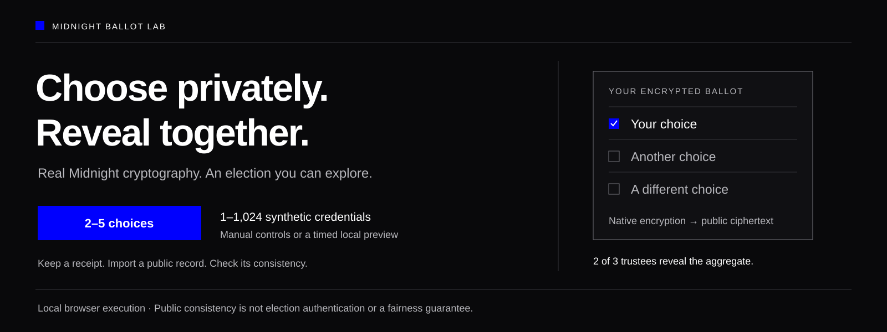
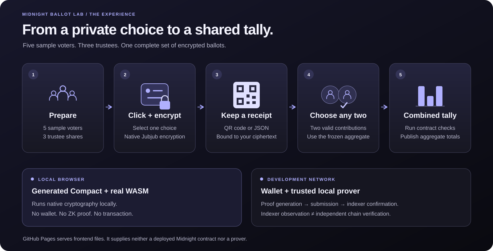
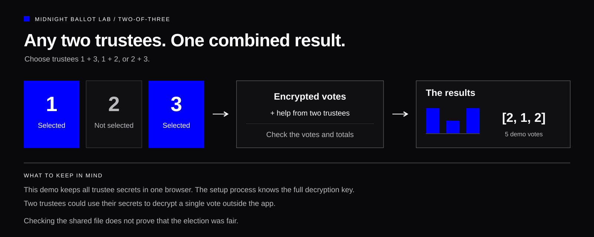
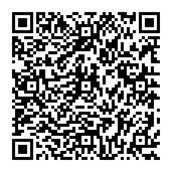

# Midnight Ballot Lab



**Cast your vote. Keep a receipt. Check the results.**

**Preview network update:** the updated browser proof checks passed locally, and genuine Lace 2.5.1 connected on the reset chain with its on-device setting saved. The wallet test stopped before funding at an indexer-service check. Later probes found that wallet indexer returning HTTP 500 while the canonical Preview indexer returned 200. A complete wallet/DUST election and publication of this update remain unverified. Check the [current verification status](docs/VERIFICATION_STATUS.md) before funding; earlier elections and balances belong to the previous chain.

## About this project

Midnight Ballot Lab makes encrypted voting easier to explore. Create an election, cast a private ballot and keep a receipt. Two of three trustees help reveal the combined totals, and every voter can check the shared results and look up their own encrypted ballot.

Built with real Midnight smart contracts and native cryptography, the lab offers a browser demo and a public Preview testnet experience. It is a hands-on research prototype: its checks help you examine an election record, but do not certify that an election was fair. [See what the checks can—and cannot—establish](docs/PUBLIC_VERIFICATION.md).

### [Open the app →](https://ibkr-bouncybot.github.io/Midnight-BallotLab/)

The homepage explains the lab and offers two ways to try it:

| Choose a mode | What it does | What you need |
| --- | --- | --- |
| [**Browser demo**](https://ibkr-bouncybot.github.io/Midnight-BallotLab/native.html) | Run real Midnight cryptography locally with **2–5 choices** and **1–1,024 demo voters**. All voters and trustees share one browser. No proofs or blockchain transactions are created. | A browser. No wallet or funds. |
| [**Public testnet**](https://ibkr-bouncybot.github.io/Midnight-BallotLab/network.html) | Create an election and cast encrypted ballots on public Preview, with Lace approving each transaction. See the [current verification status](docs/VERIFICATION_STATUS.md) for tested stages and limits. | Midnight-enabled Lace on Preview with **Run in this app (WASM)** selected, test NIGHT and usable tDUST; a browser/device with enough memory for proving. |

Anyone with the browser demo's shared election file can check that its record and totals agree. Each voter can paste a receipt ID to look up their encrypted ballot, or check a saved full receipt. An ID lookup does not prove who cast the ballot. These checks do not establish that the record is authentic or that the election was fair.

## Try an election in a few clicks

Open **Browser demo**, then:

1. **Set up election.** Add a name and your choices, then choose how many demo voters can take part. Pick manual controls or **Timed election**.
2. **Vote / Cast a ballot.** Choose a voter, click a choice and cast the ballot. Save the full receipt and copy its ID. **What happens next?** explains when results can be revealed and how to check them.
3. **Reveal results.** Select any two trustee cards to reveal the totals. A timed election closes and reveals automatically; keep the tab open.
4. **Verify election.** Upload and check the shared election file. Under **Check your own receipt**, paste the 64-character receipt ID, upload a receipt file (JSON or text), or paste the full receipt. You can do this in a new session without setting up an election. An ID lookup uses the selected record; a full receipt also carries the election details to compare.



## What makes it interesting?

| Feature | What you can explore |
| --- | --- |
| **Encrypted votes** | Midnight encrypts each vote. The shared record contains encrypted ballots, without a list of who chose what. |
| **Your own choices** | Add 2–5 choices with your own labels and up to 1,024 demo voters. |
| **One vote per demo voter** | A voter cannot cast twice in the same election. Demo voters do not establish anyone's real identity or eligibility. |
| **Timed election** | Set a countdown from 15 seconds to 60 minutes, or use manual controls to explore each step. |
| **Two trustees reveal the result** | Any two of the three trustees can help reveal the combined totals. |
| **A receipt you can keep** | Save a QR code or receipt file. It identifies the encrypted ballot and election without including the choice. |
| **Check it yourself** | Upload the election file, check that its record and totals agree, then compare your receipt. No original session is needed. |



## From a browser experiment to a test network

The [browser demo](https://ibkr-bouncybot.github.io/Midnight-BallotLab/native.html) executes generated Compact contract code and official Midnight WebAssembly locally. The [public testnet client](https://ibkr-bouncybot.github.io/Midnight-BallotLab/network.html) opens with **public Preview** and its official indexer addresses selected. No API key or local node/indexer is needed. Loading the page makes no public-network request; **Check public Preview services** runs read-only checks when you choose it, and connecting a Preview wallet repeats those checks before wallet access. Connection settings stay locked until you disconnect.

In **Set up election**, the **Save this election for later** card lets you download a public file with the network, address and fingerprint once the trustee keys are registered. Load it under **Join an election** when you return. Each trustee also gets a separate private key download to keep and load before contributing to the tally. Trustee files are unencrypted and must stay private; the app checks that each loaded share matches the joined election’s registered key.

Voter keys and receipts use matching file numbers: `midnight-voter-key-000001.private.txt` and `midnight-voter-000001-receipt.json`. Keep the original key filename when loading it later to restore its number. The number is a local filing label; it is not included in the receipt contents or shared election record.

The testnet workspace shows one screen at a time: **Connect**, **Set up election**, **Vote**, **Reveal results** and **Verify election**. Use the five blue buttons or **Back / Next** to move between them. Switching screens keeps your form values, keys, receipts and uploaded result in this tab; it does not connect a wallet or submit anything. You can go straight to **Verify election** without a wallet. Navigation waits while an action is running.

**Election activity** remains available alongside the current screen, with the contract’s voting schedule, a countdown and the last recorded phase. While an action runs, its current step and elapsed time appear beside the button and in Election activity. Elapsed time is not a completion estimate. Countdowns use your device clock; refresh the election record for the latest network status.

If voting is unavailable, **Ready to vote?** explains why and links to the next step. Register voters before the opening time, then submit **Open voting** during the voting window—the scheduled time alone does not open voting. Load the registered voter key and choose an option. Use **Refresh voting status** if another participant has opened the election or its record has changed. A used key, unresolved vote attempt or elapsed voting window keeps submission locked.

Under **Verify election**, choose **Upload a saved election record** to check a previously downloaded testnet record without connecting a wallet. Midnight's native cryptography checks the public keys, ballot receipts, combined ciphertext and any finalized totals. The page displays the saved results separately from the live network record. This checks consistency; it does not establish that the file is authentic, current or complete.

To try the public testnet, choose Midnight Preview in Lace, then select **Settings → Midnight → On this device → Run in this app (WASM)** and save the configuration. Get free test NIGHT from the [Preview faucet](https://midnight-tmnight-preview.nethermind.dev/), use **Generate tDUST** in Lace and wait for usable DUST. Keep the WASM setting selected for DUST generation and election transactions. The [network guide](docs/NATIVE_NETWORK.md#public-preview-setup) walks through setup and troubleshooting.

Ballot Lab proves contract calls in its own browser worker. Lace approves transactions and handles the separate wallet/DUST work. On the previous Preview chain, an isolated Lace 2.5.1 test completed all nine election transactions, including voting and the final tally. Eight contract proofs completed in the browser, and the saved record passed the app's checks. That full election test failed its final check for observing Lace's internal prover WASM. A [later isolated test](evidence/2026-11-07/lace-preview/fundless-diagnostic-4/README.md) passed: it captured and hash-verified the exact WASM loaded by Lace's worker and obtained a real contract proof. It used no funds and did not repeat DUST proving or network transactions. These results do not validate the reset chain or the new version graph. The [verification status](docs/VERIFICATION_STATUS.md) explains the evidence and remaining limits. Running cryptography, creating a proof and receiving network confirmation are separate milestones.

The test runs use a local application origin. Wallet connection and transactions from the hosted GitHub Pages origin remain untested, as do Preprod transactions. Other API-4 wallets are conditional candidates; Cardano-only wallets are unsupported. Mainnet is blocked in the election client.

An external development operator can wait for the real deadline, close voting and submit two trustee contributions and the final tally. It needs the trustee secrets and running wallet/network services. A deadline alone does not publish testnet results; GitHub Pages does not run this operator.

GitHub Pages hosts the frontend and public proving assets. Proof generation runs on the device; Pages does not process private proof inputs, run a Midnight node or deploy the contract. Hosting is independent of ChatGPT Sites.

Choose **Run in this app (WASM)** in Lace before connecting. The connector API does not distinguish that mode from delegated TEE proving when no server address is reported, so the app cannot independently attest your wallet setting. Reported external prover URLs are rejected, and the contract worker has no remote fallback. The first proof needs a substantial public-file download; voting proofs can take minutes and may exceed a device’s memory. Private state and recovery remain encrypted in this browser.

## A hands-on research prototype

This lab helps explain and test encrypted voting; it is not a certified election system. One browser holds all demo voter and trustee secrets. The setup process knows the full decryption key, and two cooperating trustees could decrypt individual ballots outside the app. Real elections need separate identity, device, trustee and operational safeguards.

A successful check means **the supplied record agrees with its receipts and totals**. It does not prove that the election was fair. A made-up record can agree with itself, so confirm the election details through a source you trust and keep your own receipt. The export does not include proofs that establish voter eligibility, genuine trustee contributions or blockchain acceptance. The checks also cannot prove that a device recorded the intended choice, prevent coercion or guarantee that fraud is impossible. The [verification guide](docs/PUBLIC_VERIFICATION.md) and [security boundaries](docs/THREAT_MODEL.md) explain these limits.

## Build, test and explore the source

The current source targets Compact compiler **0.36.0**, compact-runtime **0.21.0**, Midnight.js **5.0.0** and the official **zkir-v3 3.2.0** browser prover for ledger 9. On 7 November, [fresh local browser checks](evidence/2026-11-07/browser-wasm/ledger9-local/README.md) passed eight standalone proofs across seven circuits and one genuine SDK transaction proof. The browser demo flow and public-service check also passed locally. These checks used no wallet and submitted no transaction; the updated CI, deployment and reset-chain wallet election remain unverified. Exact dependency graphs are pinned in npm-generated lockfiles. Follow the [native setup guide](docs/NATIVE_MIDNIGHT.md), [Windows instructions](docs/WINDOWS_NATIVE.md), [network guide](docs/NATIVE_NETWORK.md) or [GitHub Pages guide](docs/GITHUB_PAGES.md), and read the [current verification status](docs/VERIFICATION_STATUS.md) for each stage's limits.

With the pinned Compact toolchain, Node 24 and Python installed:

```sh
npm --prefix contracts ci --ignore-scripts
npm --prefix contracts run compile
npm --prefix contracts run test:native
npm run demo
npm test
npm run build
npm --prefix contracts run build:browser:native
node scripts/build-network-browser.mjs
node contracts/node_modules/playwright/cli.js install chromium
node scripts/test-native-browser.mjs
node scripts/test-network-browser.mjs
node scripts/build-browser-proof-check.mjs
node scripts/test-browser-wasm-proofs.mjs
python3 scripts/check_pages.py
python3 -m http.server 8080 --bind 127.0.0.1 --directory dist
```

Run both browser bundlers after each static build. The build only enables the app when real generated code and assets are present. Use `python` instead of `python3` on Windows if needed.

The [latest screen-navigation checks](evidence/2026-11-06/testnet-step-screens/README.md) cover desktop/mobile use, preserved entries, saved-record uploads and browser history, alongside fresh native-election and provider tests. They do not claim new proof generation or accepted testnet transactions.

| Start here | Explore |
| --- | --- |
| [Compact contract](contracts/native-election.compact) | Eligibility, encryption, receipts, aggregation and tally constraints |
| [Native implementation](contracts/native/) | Generated-contract execution, private inputs and Midnight.js integration |
| [Browser application](src/native-app.mjs) | Clickable voting, trustee selection and public checks |
| [Independent public verifier](contracts/native/verify-public.mjs) | Strict imports, native point validation, commitments and tally consistency |
| [Automated checks](.github/workflows/) | Compilation, runtime tests, real browser checks, proving and devnet acceptance |

Private choices, randomness, credentials, secret shares and proof witnesses stay out of public exports and test logs. See the developer guides for prover handling and the remaining integration limits.

## Buy me a coffee

If the lab has been useful, you can support IBKR-BouncyBot with a little NIGHT or ADA. It's completely optional.

**NIGHT or ADA · Cardano mainnet**

Scan the QR code or copy the address below. The [support section](https://ibkr-bouncybot.github.io/Midnight-BallotLab/#support) also has a copy button.



```text
addr1q85w2v474ywzx868s69pghygek3vrhxm69e7c6ysuf28qhv8kmj5wd059grxl82f8h5mtyzl87cvqj8ldv2e0las7tnsdej9ax
```

## Noncommercial license

You can study, modify and share the project for noncommercial purposes under [PolyForm Noncommercial 1.0.0](LICENSE). Commercial use requires separate written permission from IBKR-BouncyBot. This restriction applies to project-owned material; [third-party components keep their own licenses](THIRD_PARTY_NOTICES.md).
